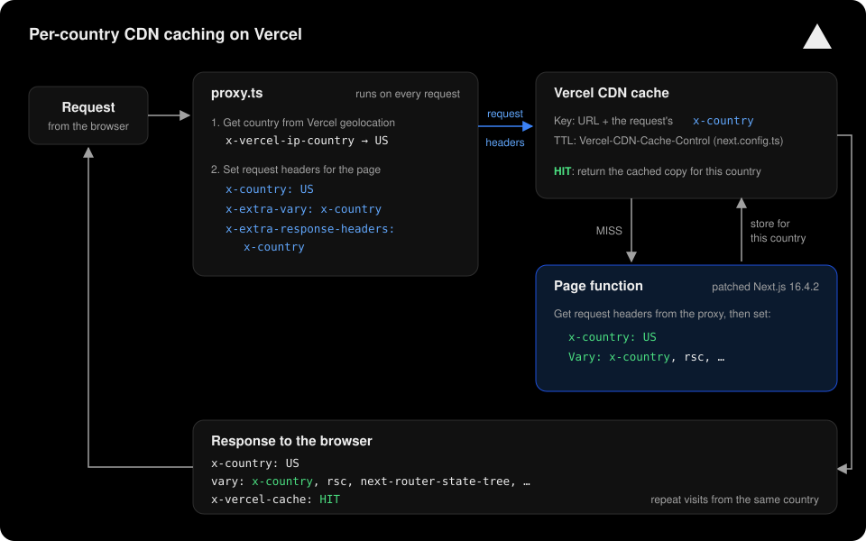

# Per-country CDN caching on Next.js + Vercel

This repo shows how to make Vercel's CDN cache a fully dynamic Next.js App Router
page **once per country**. Every page response gets:

- a `x-country` header with the visitor's country,
- `x-country` added to [`Vary`](https://vercel.com/docs/caching/cdn-cache#vary-header), and
- a CDN cache entry per country, so repeat visits are served from the cache.

```
x-country: US
vary: x-country, rsc, next-router-state-tree, next-router-prefetch, next-router-segment-prefetch
x-vercel-cache: HIT
```

**Live demo:** https://demo-vary-header-test.vercel.zone

Use this repo as a working reference while you follow the steps below.

## How it works

On Vercel, `proxy.ts` runs as [Routing Middleware](https://vercel.com/docs/routing-middleware),
before the cache, on every request. It gets the visitor's country and sets three
**request** headers for the page:

| Request header | Purpose |
|---|---|
| `x-country: US` | The cache key. The CDN keeps one copy per value, because of `Vary: x-country` |
| `x-extra-vary: x-country` | Tells the page to add `x-country` to its `Vary` |
| `x-extra-response-headers: x-country` | Tells the page to send `x-country` as a response header |

A small patch to Next.js makes the page act on the last two. A
[`Vercel-CDN-Cache-Control`](https://vercel.com/docs/caching/cache-control-headers#vercel-cdn-cache-control)
rule in `next.config.ts` lets the CDN cache the page.



The proxy can't set these response headers itself: on Vercel, the page's headers
replace the proxy's, and a proxy response header named in `Vary` breaks caching.
See [docs/background.md](docs/background.md) for the tests behind this design.

> **Documented vs. tested.** Two behaviors this design relies on are confirmed by
> tests on Vercel, not stated in Vercel's docs:
> 1. The proxy runs before the **CDN** cache lookup. The docs say middleware runs
>    "before the cache" without saying which cache.
> 2. The CDN builds its cache key from the request headers **as the proxy set them**.
>
> Confirm both with Vercel before relying on them in production.

## Prerequisites

- Next.js **16.4.2**, App Router, deployed on **Vercel**
- The pages are **fully dynamic** (`ƒ` in the build log), not
  [Partial Prerendering](https://vercel.com/docs/partial-prerendering) (`◐`)
- The pages use the Node.js runtime (the default)
- A [`proxy.ts`](https://nextjs.org/docs/app/api-reference/file-conventions/proxy) whose
  matcher covers those pages
- Yarn 1 or npm
- **The page content depends only on the URL and the country.** Cached pages are
  shared by everyone in that country, so they must not show per-user content
  (cart, account, login state)

For other Next.js versions or package managers, see
[docs/background.md](docs/background.md#other-nextjs-versions-and-package-managers).

## Set it up

### 1. Install patch-package

Install [patch-package](https://github.com/ds300/patch-package), which re-applies
the Next.js patch after every install:

```bash
yarn add --dev --exact patch-package@8.0.1 postinstall-postinstall@2.1.0
```

In `package.json`, add a `postinstall` script and pin `next` to an exact version:

```json
"scripts": {
  "postinstall": "patch-package"
},
"dependencies": {
  "next": "16.4.2"
}
```

In a monorepo, do this in the workspace where `next` is installed.

### 2. Add the patch

Copy [`patches/next+16.4.2.patch`](patches/next+16.4.2.patch) into a `patches/`
folder, then install:

```bash
yarn install
```

The output should include `next@16.4.2 ✔`.

### 3. Add the header module

Copy [`lib/country.ts`](lib/country.ts). It provides two functions:

| Function | What it does |
|---|---|
| `resolveCountry(headers)` | Gets the country from Vercel's [`x-vercel-ip-country`](https://vercel.com/docs/headers/request-headers#x-vercel-ip-country) header |
| `setCountryRequestHeaders(headers, country)` | Sets the three request headers above |

### 4. Call it from `proxy.ts`

```ts
import { NextResponse, type NextRequest } from "next/server";
import { resolveCountry, setCountryRequestHeaders } from "@/lib/country";

export function proxy(request: NextRequest) {
  const headers = new Headers(request.headers);
  setCountryRequestHeaders(headers, resolveCountry(request.headers));
  return NextResponse.next({ request: { headers } });
}

export const config = {
  matcher: ["/((?!_next/static|_next/image|favicon.ico).*)"],
};
```

- Pass the headers with
  [`NextResponse.next({ request: { headers } })`](https://nextjs.org/docs/app/api-reference/functions/next-response#next).
  Without the `request` option, the page never receives them.
- Don't set `x-country` on the proxy's **response**. It stops the CDN from
  caching per country.

### 5. Let the CDN cache the pages

In `next.config.ts`, add a
[`Vercel-CDN-Cache-Control`](https://vercel.com/docs/caching/cache-control-headers#vercel-cdn-cache-control)
header for the pages to cache, using
[`headers()`](https://nextjs.org/docs/app/api-reference/config/next-config-js/headers):

```ts
async headers() {
  return [
    {
      source: "/products/:path*",
      headers: [{ key: "Vercel-CDN-Cache-Control", value: "max-age=60" }],
    },
  ];
},
```

`max-age` is how long the CDN keeps each copy, in seconds. This header takes
priority over the page's own `Cache-Control` for Vercel's CDN, and Vercel removes
it before the response reaches the browser
([how the headers interact](https://vercel.com/docs/caching/cache-control-headers#behavior)).
So browsers still get the page's `Cache-Control: private, no-cache, no-store, …`
and don't cache it themselves.

### 6. Deploy

Deploy to Vercel. In the build log, check for:

```
next@16.4.2 ✔
├ ƒ /your-page
```

If you pin Yarn with `packageManager` in `package.json`, also set the project
environment variable
[`ENABLE_EXPERIMENTAL_COREPACK=1`](https://vercel.com/docs/builds/configure-a-build#corepack).

## Check that it works

Request the same page twice:

```bash
curl -sI https://your-app.vercel.app/your-page | grep -iE "^(x-country|vary|x-vercel-cache):"
```

Expected (from the US), first `MISS`, then `HIT`
([`x-vercel-cache` values](https://vercel.com/docs/headers/response-headers#x-vercel-cache)):

```
x-country: US
vary: x-country, rsc, next-router-state-tree, next-router-prefetch, next-router-segment-prefetch
x-vercel-cache: HIT
```

`Cache-Control` still says `no-store` on a `HIT`. That's expected: it's addressed
to the browser, while `Vercel-CDN-Cache-Control` (removed in transit) controls
Vercel's CDN.

Visitors can't change the country. Sending `x-country` or `x-vercel-ip-country`
request headers has no effect.

Test on a deployment, not with `next dev`. Locally there's no Vercel geolocation
and no CDN.

## Limitations

- **Don't cache per-user pages.** Everyone in a country shares one cached copy.
- **Responses that set cookies aren't cached.** Vercel skips caching responses
  with `Set-Cookie`
  ([cacheable response criteria](https://vercel.com/docs/caching/cdn-cache#cacheable-response-criteria)).
- **Each Vercel region fills its own cache.** The first request per country, per
  region, renders the page ([CDN cache limits](https://vercel.com/docs/caching/cdn-cache#limits)).
- **Partial Prerendering pages (`◐`)** keep the `Vary` from build time, so
  `x-country` isn't added.
- **Edge-runtime pages** aren't covered by the patch.
- **The patch only applies to Next.js 16.4.2.** Regenerate it when you upgrade
  ([docs/background.md](docs/background.md#regenerating-the-patch)).

## Troubleshooting

| Problem | Fix |
|---|---|
| Always `x-vercel-cache: MISS` | Check that the `Vercel-CDN-Cache-Control` rule covers the page, the response has no `Set-Cookie`, and the proxy doesn't set `x-country` as a response header. [Cache status reasons](https://vercel.com/docs/caching/cache-status) can help |
| Always `HIT`, but the wrong country | The proxy is setting `x-country` as a response header. Set it on the request only (step 4) |
| `vary` or `x-country` missing | Check that the page is `ƒ` in the build log, the proxy matcher covers it, and you pass `{ request: { headers } }` |
| Build fails with `Failed to apply patch for package next` after you change the patch | Redeploy once without the build cache ([`vercel deploy --force`](https://vercel.com/docs/cli/deploy#force), or **Redeploy** with **Use existing Build Cache** turned off) |
| Every page returns 404 on Vercel | Set the project's [Framework Preset](https://vercel.com/docs/builds/configure-a-build#framework-preset) to Next.js |

## About this repo

| Path | Purpose |
|---|---|
| `lib/country.ts` | **The implementation.** Copy this |
| `proxy.ts` | Blocks marked `PRODUCTION` are the implementation; `POC` blocks drive the demo |
| `next.config.ts` | The `Vercel-CDN-Cache-Control` rule |
| `patches/next+16.4.2.patch` | The Next.js patch |
| `scripts/apply-vary-patch.mjs` | Generates the patch and documents each change |
| `components/`, `app/page.tsx` | Demo page only |
| `docs/background.md` | Why it works, the tests behind it, other versions |

To run the demo locally: `yarn install && yarn dev`, then open
`http://localhost:3000/?country=DE`. The `?country=` and `?region=` overrides are
for the demo only.
